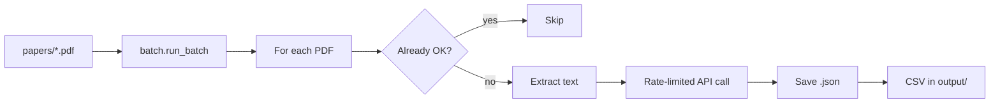

# Architecture (up to 400 papers)

This project processes **one batch of up to 400 PDFs** — your `RAG Pilot Papers/` folder.

## Layout

```
systematic-review-processor/
├── RAG Pilot Papers/                # Your PDFs (input, up to 400)
├── output/                          # JSON per paper + CSV + change log + log
├── Claude_Code_Prompting_v4.docx   # Coding prompt
├── run_review.py                    # One command: process the whole folder
├── systematic_review_processor.py # CLI (same logic, custom paths)
├── run_server.py                    # Web UI (FastAPI) at 127.0.0.1:8000
├── api/                             # FastAPI app, job runner, workspace
├── web/                             # Vanilla HTML/CSS/JS UI
└── sr_processor/                    # Core library
    ├── config.py      # Settings (workers, retries, paths)
    ├── batch.py       # Run all PDFs, progress, summary
    ├── paper.py       # One PDF: skip / retry / save
    ├── api.py         # Anthropic + retries + JSON parse
    ├── rate_limiter.py# Gap between API calls (fewer 429s)
    ├── pdf.py         # Text extraction
    ├── prompt.py      # Load .docx prompt
    ├── change_log.py  # change_log.csv — papers needing attention
    └── csv_export.py  # systematic_review_results.csv in output/
```

## Flow



## Design choices

| Choice | Why |
|--------|-----|
| Max **400** PDFs | Covers the full review set with headroom |
| **1 worker** (sequential) | Most stable against Anthropic rate limits |
| **~4–5s gap** between API calls | Shared limiter keeps requests under the limit |
| Retry **failed** + **parse_error** | Rerun fixes `*_ERROR.json` without deleting good results |
| CSV + **change log** inside **output/** | One folder for supervisor handoff |
| **batch_summary.json** | Machine-readable run stats |

## Commands

```bash
# Easiest — process the whole RAG Pilot Papers folder
python3 run_review.py

# Same with explicit CLI
python3 systematic_review_processor.py \
  --pdf-folder ./papers \
  --output-folder ./output \
  --prompt-file ./Claude_Code_Prompting_v4.docx \
  --workers 2

# After failures (rate limit, etc.)
python3 run_review.py --workers 1
# or delete output/*_ERROR.json and rerun
```

## Outputs

| File | Purpose |
|------|---------|
| `output/{Paper}.json` | Coded fields per paper |
| `output/{Paper}_ERROR.json` | Failed run — read `"error"` |
| `output/systematic_review_results.csv` | All papers for Excel |
| `output/change_log.csv` | Papers that failed, hit a parse error, or need human review |
| `output/processor.log` | Full log |
| `output/batch_summary.json` | Counts: success / failed / skipped |

## Scaling beyond 400

Use **separate folders** (e.g. `batch_01` … `batch_10`) and `sr_processor.merge.merge_batch_csvs()` to combine the per-batch CSVs.
