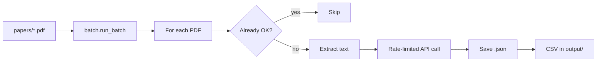

# Architecture (20 papers)

This project is scoped for **one batch of up to 20 PDFs** — your current `papers/` folder.

## Layout

```
systematic-review-processor/
├── papers/                          # Your 20 PDFs (input)
├── output/                          # JSON per paper + CSV + log
├── Claude_Code_Prompting_v4.docx   # Coding prompt
├── run_review.py                    # One command: process all 20
├── systematic_review_processor.py # CLI (same logic, custom paths)
└── sr_processor/                    # Core library
    ├── config.py      # Settings (workers, retries, paths)
    ├── batch.py       # Run all PDFs, progress, summary
    ├── paper.py       # One PDF: skip / retry / save
    ├── api.py         # Anthropic + retries + JSON parse
    ├── rate_limiter.py# Gap between API calls (fewer 429s)
    ├── pdf.py         # Text extraction
    ├── prompt.py      # Load .docx prompt
    └── csv_export.py  # systematic_review_results.csv in output/
```

## Flow



## Design choices (20 papers)

| Choice | Why |
|--------|-----|
| Max **20** PDFs | Matches your dataset; avoids accidental huge runs |
| **2 workers** default | Reduces Anthropic rate-limit errors |
| **3s gap** between API calls | Shared limiter across threads |
| Retry **failed** + **parse_error** | Rerun fixes `*_ERROR.json` without deleting good results |
| CSV inside **output/** | One folder for supervisor handoff |
| **batch_summary.json** | Machine-readable run stats |

## Commands

```bash
# Easiest — your 20 papers
python3 run_review.py

# Same with explicit CLI
python3 systematic_review_processor.py \
  --pdf-folder ./papers \
  --output-folder ./output \
  --prompt-file ./Claude_Code_Prompting_v4.docx \
  --workers 2

# After failures (rate limit, etc.)
python3 run_review.py --workers 1
# or delete output/*_ERROR.json and rerun
```

## Outputs

| File | Purpose |
|------|---------|
| `output/{Paper}.json` | Coded fields per paper |
| `output/{Paper}_ERROR.json` | Failed run — read `"error"` |
| `output/systematic_review_results.csv` | All papers for Excel |
| `output/processor.log` | Full log |
| `output/batch_summary.json` | Counts: success / failed / skipped |

## Scaling to 300 later

Use **separate folders** (e.g. `batch_01` … `batch_10` with 30 PDFs each) and `sr_processor.merge.merge_batch_csvs()`. Not required for the current 20-paper workflow.
